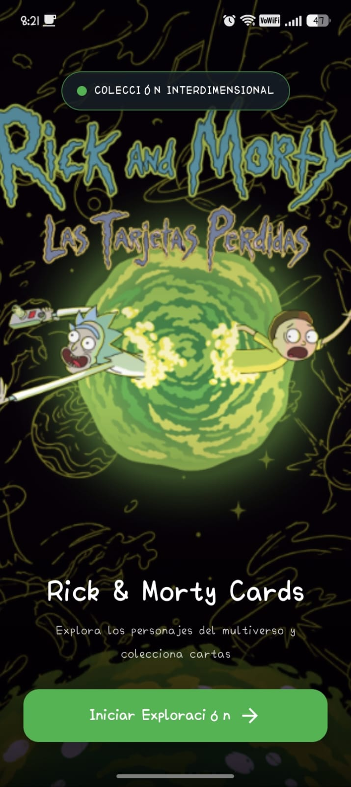
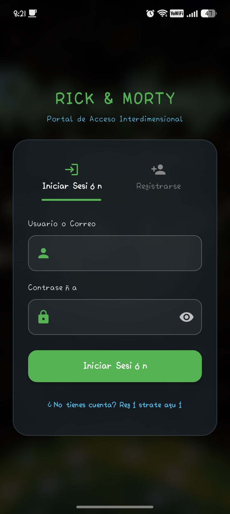
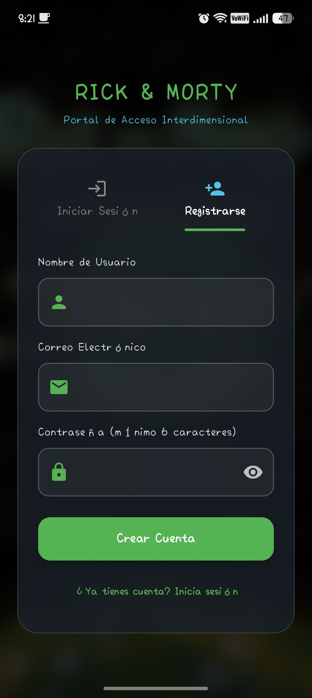
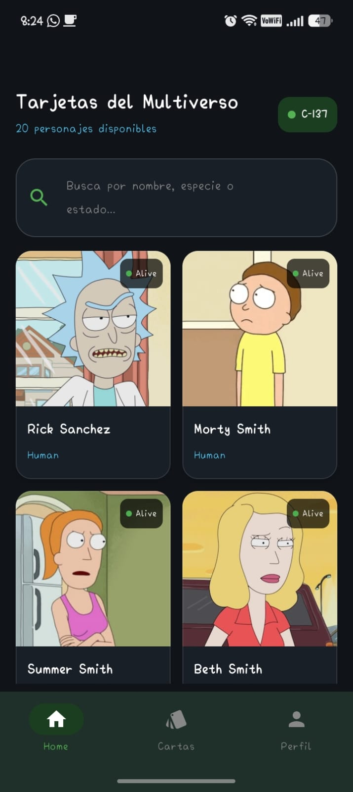
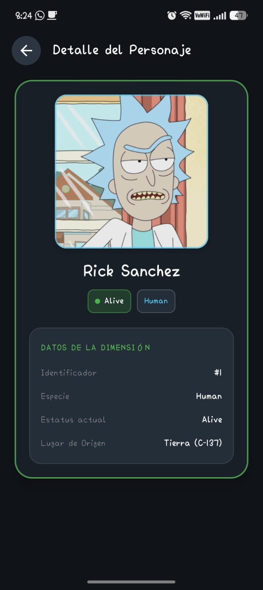
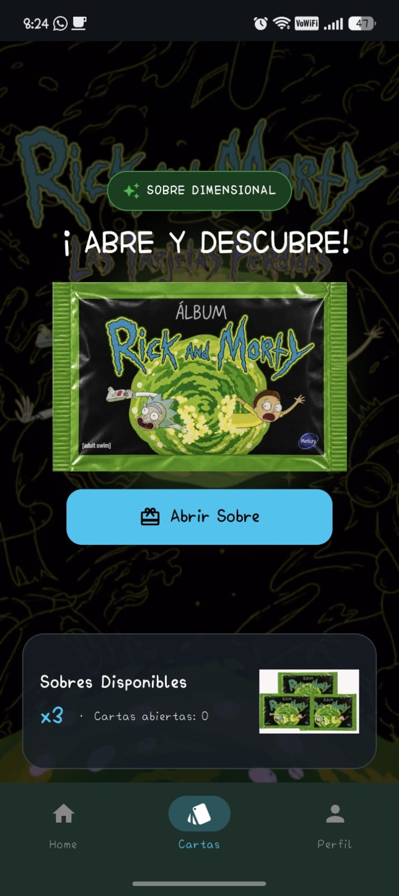
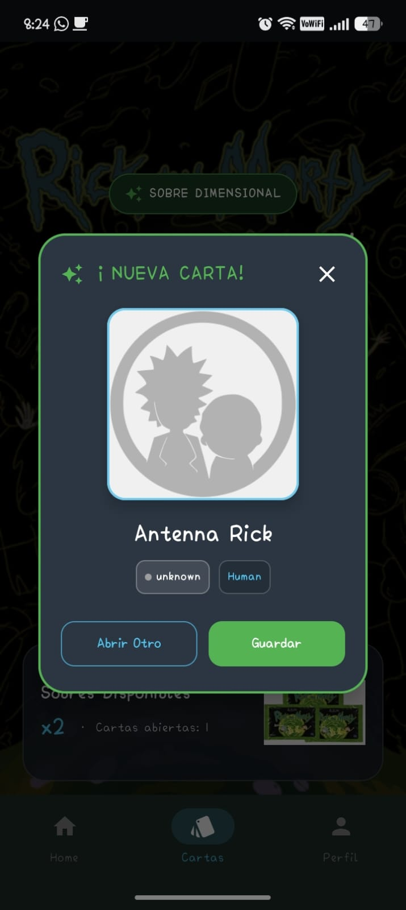
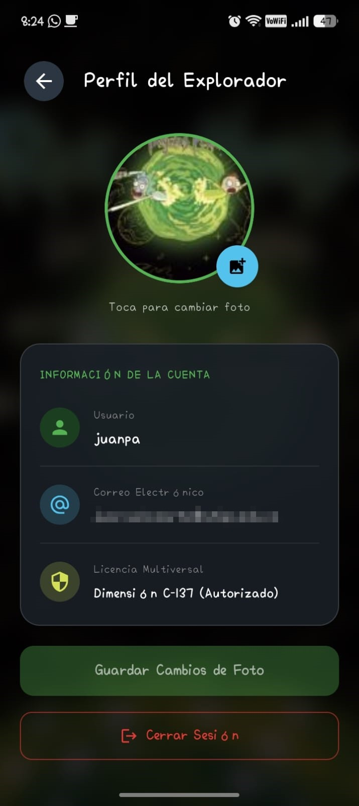

# Rick & Morty Cards — Las Tarjetas Perdidas

Aplicación Android hecha con **Kotlin** y **Jetpack Compose** (Material 3) para explorar a los personajes
de Rick and Morty y coleccionarlos abriendo sobres. Consume la [Rick and Morty API](https://rickandmortyapi.com/)
y usa **Firebase** para el registro, el inicio de sesión y el perfil del usuario.

## Capturas de pantalla

<table>
  <tr>
    <td align="center"><br><sub><b>Inicio</b></sub></td>
    <td align="center"><br><sub><b>Iniciar sesión</b></sub></td>
    <td align="center"><br><sub><b>Registro</b></sub></td>
    <td align="center"><br><sub><b>Home: personajes</b></sub></td>
  </tr>
  <tr>
    <td align="center"><br><sub><b>Detalle del personaje</b></sub></td>
    <td align="center"><br><sub><b>Sobres</b></sub></td>
    <td align="center"><br><sub><b>Nueva carta</b></sub></td>
    <td align="center"><br><sub><b>Perfil</b></sub></td>
  </tr>
</table>

## Funcionalidades

- **Pantalla de inicio (splash)** con arte de fondo y botón *Iniciar Exploración*. Si ya hay una sesión abierta
  entra directo al Home; si no, va al login.
- **Registro e inicio de sesión** con Firebase Authentication. Se puede entrar con **usuario o correo** y contraseña.
  El registro valida el nombre de usuario (mínimo 3 caracteres, sin espacios ni `@`), el correo y la contraseña (mínimo 6 caracteres).
- **Home**: cuadrícula de personajes obtenidos de la API, con buscador por **nombre, especie o estado**.
  Si la API no responde, la app usa una lista local de personajes de respaldo.
- **Detalle del personaje**: imagen, nombre, estado y especie.
- **Sobres**: se empieza con 3 sobres; cada vez que se abre uno aparece un personaje aleatorio en un diálogo
  con las opciones *Abrir Otro* y *Guardar*, y se lleva la cuenta de cartas abiertas.
- **Perfil**: muestra usuario y correo, permite cambiar la foto desde la galería y cerrar sesión.
- **Barra de navegación inferior** en *Home* y *Cartas*, con acceso a *Perfil*.

## Tecnologías

| Área | Herramienta |
| --- | --- |
| Lenguaje | Kotlin 2.2.10 |
| UI | Jetpack Compose + Material 3 (Compose BOM 2026.02.01) |
| Navegación | Navigation Compose 2.9.8 |
| Estado | `ViewModel` + `mutableStateOf` (lifecycle-viewmodel-compose 2.11.0) |
| Red | Retrofit 3.0.0 + conversor Gson |
| Imágenes | Coil 2.7.0 |
| Backend | Firebase Authentication + Cloud Firestore (Firebase BoM 34.0.0) |
| Android | `minSdk` 24 · `targetSdk` 37 |

## Estructura del proyecto

```
app/src/main/java/com/danidev/apprickmorty/
├── MainActivity.kt                 # Punto de entrada: tema + AppNavigation
├── data/
│   ├── model/
│   │   └── Character.kt            # RickCharacter, Origin, CharacterResponse
│   ├── remote/
│   │   └── RickAndMortyApi.kt      # Interfaz Retrofit y RetrofitClient
│   └── repository/
│       └── CharacterRepository.kt  # Acceso a la API, devuelve Result<List<RickCharacter>>
└── ui/
    ├── Auth/
    │   └── AuthViewModel.kt        # Login, registro, perfil y foto con Firebase
    ├── navigation/
    │   └── AppNavigation.kt        # Rutas y NavHost
    ├── screens/
    │   ├── FigureViewerScreen.kt   # Splash, Home, detalle y barra de navegación inferior
    │   ├── LoginScreen.kt          # Login y registro
    │   ├── PacksScreen.kt          # Apertura de sobres
    │   └── ProfileScreen.kt        # Perfil del usuario
    ├── theme/
    │   ├── Color.kt                # Paleta de colores
    │   ├── Theme.kt                # Tema Material 3
    │   └── Type.kt                 # Tipografías
    └── viewModel/
        └── CharacterViewModel.kt   # Lista, filtro de búsqueda y sobres
```

### Capa de datos (`data`)

Obtiene y transforma la información.

- **`model`** (`Character.kt`): clases de datos que representan la respuesta de la API (`RickCharacter` con id, nombre,
  estado, especie, imagen y origen).
- **`remote`** (`RickAndMortyApi.kt`): interfaz de Retrofit con los endpoints `character` y `character/{id}` sobre
  `https://rickandmortyapi.com/api/`.
- **`repository`** (`CharacterRepository.kt`): intermediario entre la API y la interfaz. Envuelve la llamada en un
  `Result` para que la UI maneje el éxito o el error sin conocer los detalles de la red.

### Capa de interfaz (`ui`)

Todo lo que el usuario ve e interactúa.

- **`Auth`**: `AuthViewModel` gestiona sesión, registro, datos del perfil y foto.
- **`navigation`**: define las rutas (`splash`, `login`, `home`, `packs`, `profile`, `detail`) y el `NavHost`.
- **`screens`**: pantallas hechas con composables de Jetpack Compose.
- **`theme`**: identidad visual de la app (colores, tipografía y tema oscuro de Material 3).
- **`viewModel`**: `CharacterViewModel` carga los personajes, aplica el filtro del buscador y controla los sobres.

## Flujo de navegación

1. **Splash** → **Login / Registro** (o directo a **Home** si ya hay sesión).
2. **Home** ⇄ **Cartas**, ambas con la barra inferior; desde cualquiera de las dos se entra a **Perfil**.
3. Desde **Home**, tocar un personaje abre su **Detalle**; la flecha de volver regresa al Home.
4. En **Perfil**, *Cerrar sesión* vuelve al **Login**.

## Datos en Firebase

- **Authentication**: proveedor *Correo y contraseña*.
- **Firestore**: colección `usuarios`, un documento por usuario (id = `uid`) con los campos
  `username`, `usernameLower`, `email` y `photoBase64` (foto de perfil reducida a 256 px y guardada en Base64).

## Cómo ejecutarlo

1. Clona el repositorio y ábrelo con **Android Studio**.
2. Crea un proyecto en [Firebase](https://console.firebase.google.com/) y registra una app Android con el
   paquete `com.danidev.apprickmorty`.
3. Descarga tu `google-services.json` y colócalo en `app/`.
4. En Firebase activa **Authentication → Correo y contraseña** y crea una base de datos **Firestore**.
   El login por nombre de usuario consulta la colección `usuarios` por el campo `usernameLower`, así que las
   reglas de Firestore deben permitir esa lectura.
5. Sincroniza Gradle y ejecuta la app en un emulador o dispositivo con Android 7.0 (API 24) o superior.
   Necesita conexión a internet.

## Créditos

Datos e imágenes de personajes: [The Rick and Morty API](https://rickandmortyapi.com/).
Rick and Morty es propiedad de Adult Swim; este proyecto es un ejercicio educativo sin fines de lucro.

---

El README fue hecho con ayuda de Claude!
